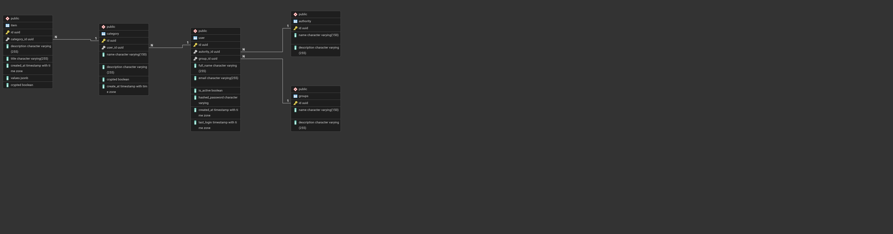

# Introduction

This application is developed amid to store categorized information in secure way.
The user can choose to crypt or no information.

The actors of application are:

### Group: 
Define Groups of users.  

### Authority 
Contains users roles. 
There are this roles in application

- ADMIN: Can manage Groups, users, but manage only Categories and items created by itself
- OWNER: Can manage manage users inside own Group but manage only Categories and items created by itself 
- USER: Can manage only Categories and items created by itself

### User
The User can has one authority and one group.
The users can have one or many Categories.
Each users manage only own categories and items.

### Category
The category defines a set of elements.
The category have one or many Items and only owner can manage its.

### Item
The item rappresents the information to be stored inside category.
The information can be a note, or simple text. The users can crypt the information o leave it plain text.
Only Users tha own the items can manage it.

# Architecture

# Database

the below figure depicts the database structure:

